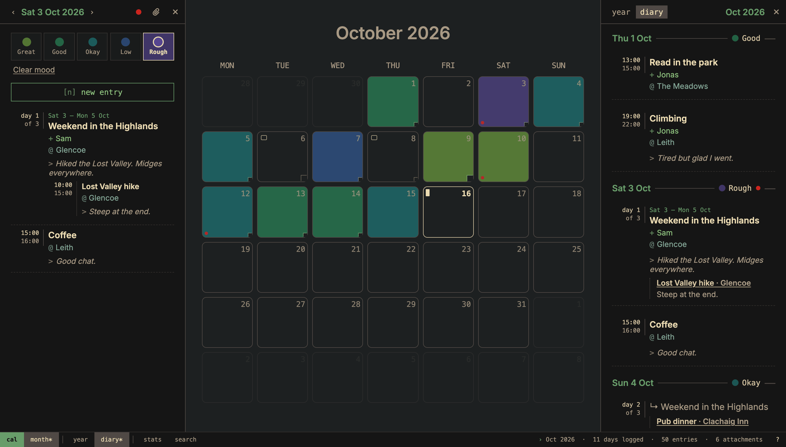
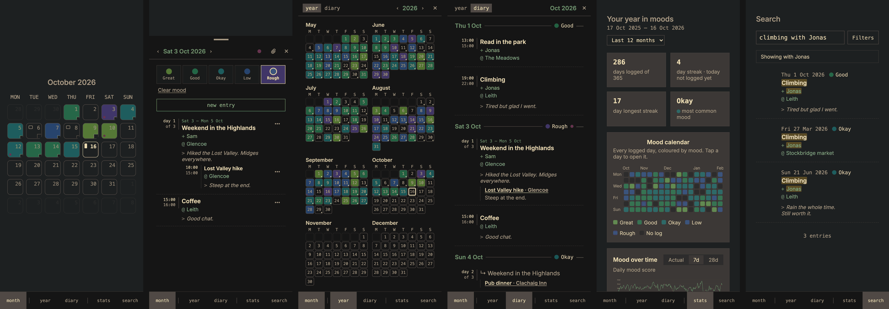

# Calendar

A personal life log: how each day felt, what happened, and the receipts and tickets that go with it. A mood mosaic in a gruvbox terminal logbook.





## Features

- **The month** is the centrepiece. Each day is a tile tinted by its mood; its corner folds further the more you wrote, a notch marks a photo or ticket, and a caret marks today.
- **Day panel** (left, tap a day): the day's mood, a private marker, entries with optional times, people, places and notes, moments inside an entry, and photos or PDFs. Half-written entries are kept as drafts.
- **Year / Diary drawer** (right, `y` / `d`): the year as a navigator, or the month on screen written out day by day.
- **Stats**: streaks, mood over time and by weekday, and your mood with each person and place.
- **Search** by meaning, words or filters ("dinner with Sam last month"), entirely on-device.
- **Safe to use**: deletes go to a 30-day trash with Undo, and the whole diary exports as a zip (from the Stats page).
- **Installable** on a phone, and days you've opened stay readable offline.
- **Keyboard-first**: `?` lists every shortcut.

## Run it

```bash
uv sync
uv run flask --app app:create_app db upgrade
uv run flask --app app:create_app run --port 8001   # http://127.0.0.1:8001
```

On an Intel Mac `uv sync` fails: the locked `onnxruntime` (used by search) has no wheel for it. Use another machine, or a separate environment with `onnxruntime<1.20`.

Tests and lint: `uv run pytest` and `uv run ruff check .`

## Home stack

Served at `/calendar/` behind the [dashboard](../dashboard)'s nginx, which signs people in and passes the user on. Set:

```bash
AUTH_PROXY_HEADER=X-Forwarded-User
APPLICATION_ROOT=/calendar
```

Leave both unset for standalone development. After adding a user in the dashboard, run `uv run python scripts/sync_household_users.py` there.

Commits merged to `master` that pass CI deploy to the Pi on their own (see the dashboard README). The database is `instance/events.db`; the container applies migrations when it starts.

## Commands

```bash
uv run flask --app app:create_app reindex         # rebuild the search index
uv run flask --app app:create_app purge-deleted   # empty the trash (> 30 days)
uv run flask --app app:create_app db migrate -m "what changed"   # after editing models.py
```

Search settings (optional): `SEARCH_DENSE_MIN_SCORE` (default `0.6`; lower for more matches) and `FASTEMBED_CACHE_PATH` (where the embedding model lives; the Docker image bakes it in).

## For other apps

The phone scanner app posts receipts to `POST /attachments` (`file`, `year`, `month`, `day`): images and PDFs up to 10 MB, HEIC converted to JPEG. The home stack's MCP server uses the JSON endpoints under `/events`, `/mood`, `/search/data` and `/stats/data`.
